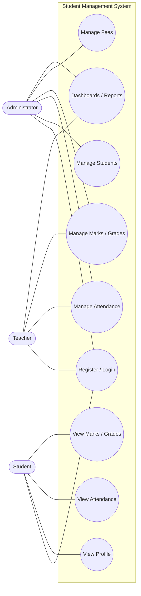
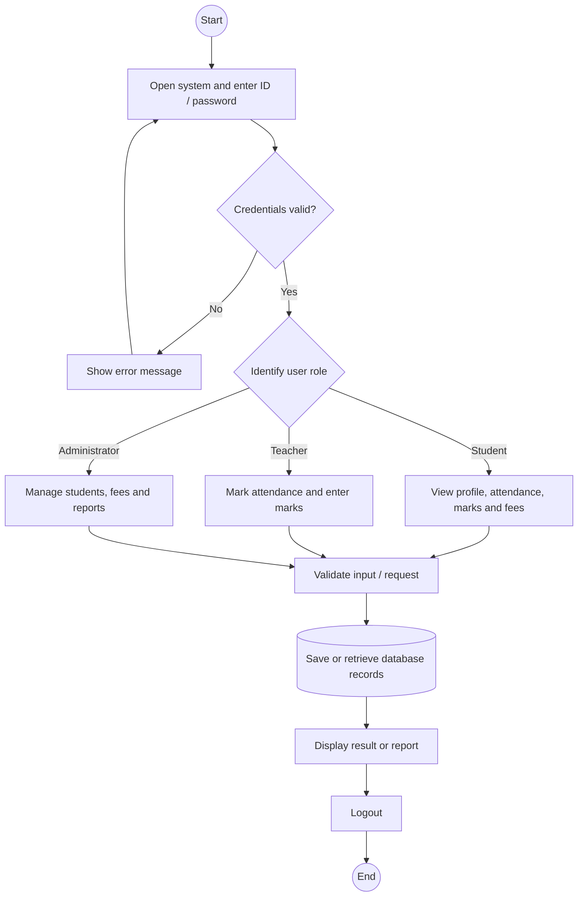
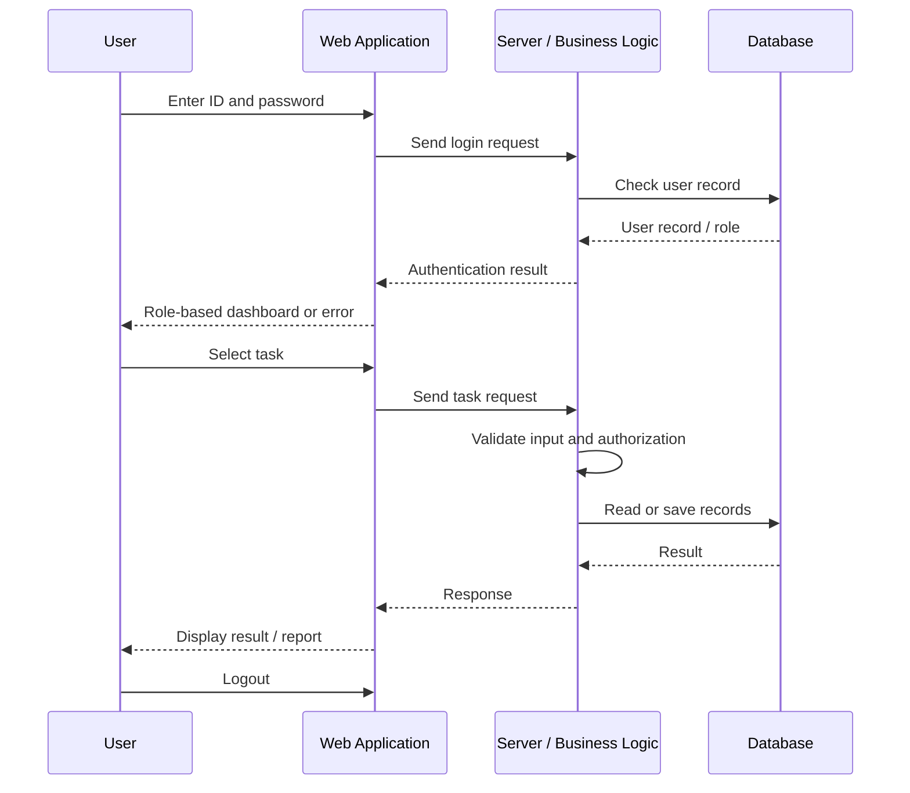
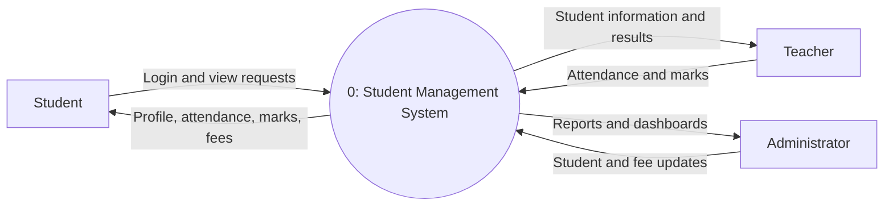
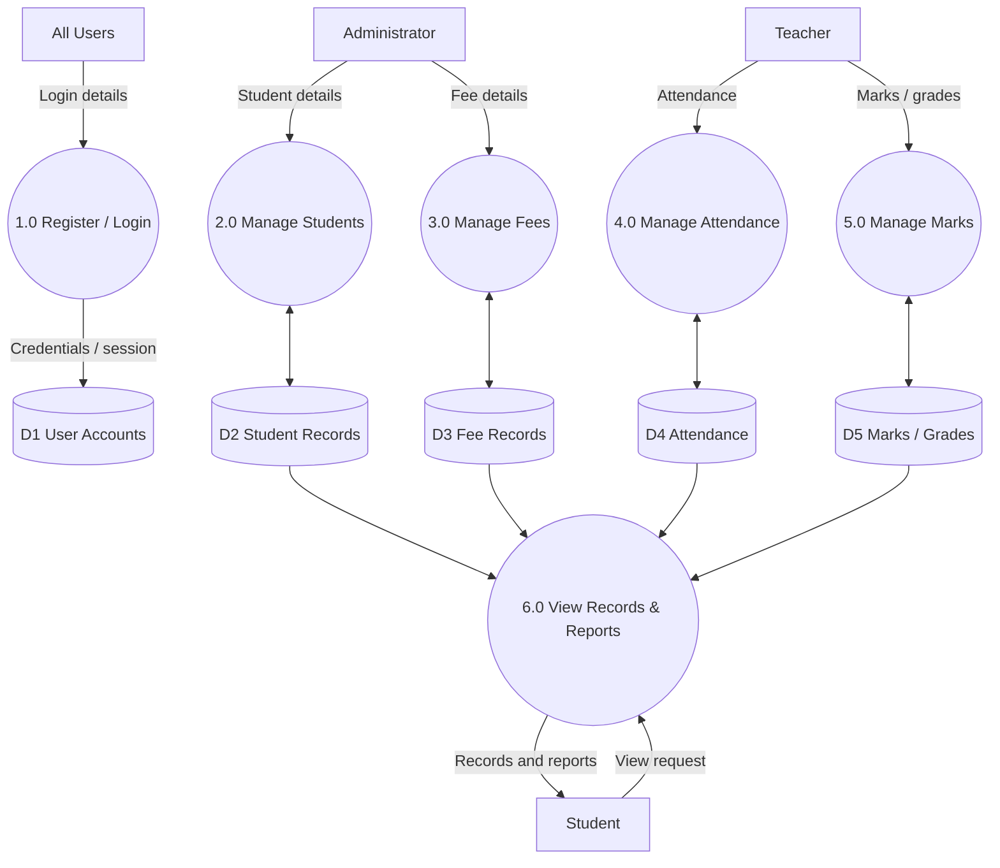
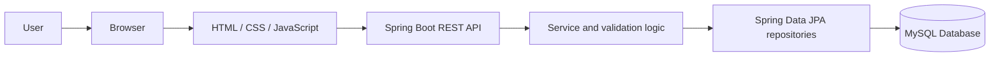

# System diagrams (implementation-aligned)

These Mermaid diagrams restate the workflows shown in the supplied presentation. They are source diagrams for documentation and can be rendered in Mermaid-compatible Markdown viewers.

## Use case diagram

## Activity diagram

## Swimlane sequence

## DFD Level 0 – Context diagram

## DFD Level 1

## Architecture

